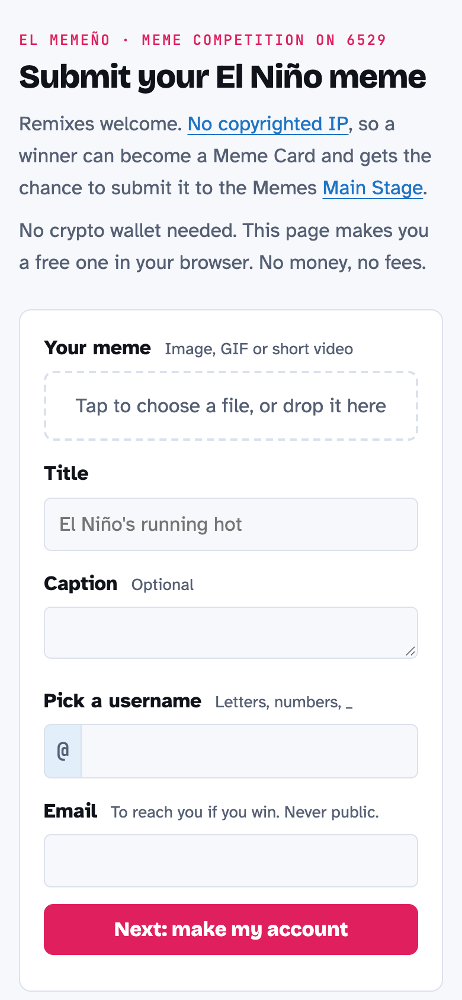

# el-memeno-wallet

Enter the **El Memeño** meme competition on [6529.io](https://6529.io) without a crypto wallet.

Live at **[elmemeno.tito.co/submit](https://elmemeno.tito.co/submit)**.



6529 only lets you sign in with an Ethereum wallet. Most people with a good El Niño meme don't have one. This page makes one for them, right in the browser, and posts their meme to the competition. No money, no fees, no extensions.

## What it does

1. The visitor picks a meme, a title, a username and an email.
2. The page makes a new wallet in their browser with [ethers.js](https://docs.ethers.org/v6/) (`Wallet.createRandom()`: 12 words, 128 bits from `crypto.getRandomValues`, MetaMask's derivation path).
3. It shows the 12 words and won't continue until they tick "I saved my 12 words".
4. It signs in to 6529, creates their profile (profile picture = a square crop of their meme), uploads the meme and posts it as an entry in the wave.
5. Later they can import the 12 words into MetaMask and sign in at 6529.io like anyone else.

## What leaves the browser

| Goes to | What | Never |
|---|---|---|
| 6529 API | profile, meme, entry, signed with a session token | the 12 words |
| `login` relay | one sign-in signature and the wallet address | the 12 words |
| `s3put` relay (only if needed) | the meme's bytes and a one-time upload URL | the 12 words |
| Netlify Forms | email, username, wallet address, title, entry link | the 12 words |

The organizers can't recover anyone's account. Lose the words and the account is gone.

### Why the relays

- **`netlify/functions/login.mjs`**: 6529 blocks other websites' browsers from calling `/api/auth/session-login`. Every other endpoint allows any origin. The relay forwards the signed sign-in request using 6529's documented [native flow for external clients](https://6529.io/tools/api/authentication) and returns the token. It logs nothing.
- **`netlify/functions/s3put.mjs`**: a fallback in case 6529's upload bucket refuses this site's origin. It only forwards to presigned `*.amazonaws.com` URLs.

## Run it

```sh
npx netlify-cli dev          # http://localhost:8888
npx netlify-cli deploy --prod
```

Netlify Forms needs form detection on (Site settings → Forms).

## Use it for another wave

Change `WAVE_ID` near the top of the script in `index.html`, and the copy. The wave must allow anyone to submit.

## License

[CC0](LICENSE), like the Memes.
